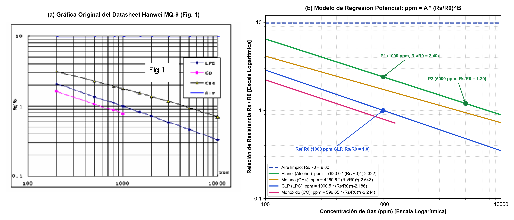

# Módulo Integrado de Gas (MQ-9) y Corriente (ACS758LCB) con Arduino Nano

Este directorio contiene el firmware y la documentación técnica para la adquisición simultánea del sensor de gases **MQ-9** (Etanol / Monóxido de Carbono / Combustibles) y el sensor de corriente **ACS758LCB-050B** (Monitoreo de consumo de batería LiPo 3S del Robot Primario Chipo), procesados mediante un **Arduino Nano** y transmitidos vía USB a la **Raspberry Pi 5** (o PC).

---

## 📌 1. Mapeo de Conexiones Físicas

### Esquemático Rápido

```text
                        ┌────────────────────────┐
                        │      ARDUINO NANO      │
                        │                        │
  [MQ-9 Gas]            │                        │   [ACS758 Corriente]
  VCC ──────────────────┤ 5V                  5V ├── VCC
  GND ──────────────────┤ GND                GND ├── GND
  A0 (Voltaje Gas) ─────┤ A0                  A1 ├── OUT / OU1 (Voltaje Corriente)
  D0 (Alarma Digital) ──┤ D2                     │
                        └────────────────────────┘
```

### Tabla de Pines

| Sensor | Pin del Sensor | Pin en Arduino Nano | Descripción de la Señal |
| :--- | :--- | :--- | :--- |
| **MQ-9 (Gas)** | **VCC** | **5V** | Alimentación del micro-calefactor de silicio ($\approx 150-180\text{ mA}$). |
| | **GND** | **GND** | Masa de referencia común. |
| | **A0** | **Pin A0** | Entrada analógica con sobremuestreo (Voltaje proporcional a concentración de gas). |
| | **D0** | **Pin D2** | Entrada digital de interrupción/alarma (Active-LOW, regulada por el potenciómetro LM393). |
| **ACS758 (Corriente)** | **VCC** | **5V** | Alimentación lógica del sensor ($5.00\text{ V}$). |
| | **GND** | **GND** | Tierra de referencia para el cero de reposo ($V_{offset} \approx 2.50\text{ V}$). |
| | **OUT / OU1** | **Pin A1** | Salida analógica proporcional a la corriente ($40\text{ mV/A}$). |
| | **IP+ / IP-** | *En serie con la carga* | Terminales de potencia en serie con la batería LiPo 3S del robot. |

> **IMPORTANTE (Conexión en Estrella):** Llevar cables independientes de 5V y GND desde el Nano hacia el MQ-9 y hacia el ACS758. Evitar puentear la alimentación de un sensor a través del otro en el protoboard para que el consumo del calefactor del MQ-9 no introduzca caídas de tensión en la medición de corriente ratiométrica.

---

## 📐 2. Modelo Físico-Matemático: Transducción de Voltaje a Concentración (PPM)

Para convertir la señal de voltaje leída en el pin analógico `A0` a concentración real en **partes por millón ($\text{ppm}$)**, se implementó el modelo de quimisorción sobre óxidos metálicos semiconductores ($\text{SnO}_2$) basado en la **Ley de Potencias de Wolkenstein-Clifford** y las curvas de sensibilidad de la **Figura 3 del Datasheet oficial de Hanwei Electronics / Winsen MQ-9**.

### 2.1 Cadena de Transducción Eléctrica

1. **Lectura y Conversión Analógica-Digital (ADC):**
   $$V_{out} = \text{ADC} \times \left(\frac{V_{CC}}{1023}\right) = \text{ADC} \times \left(\frac{5.000\text{ V}}{1023}\right)$$

2. **Cálculo de la Resistencia del Sensor ($R_s$):**
   El módulo breakout integra un divisor de tensión resistivo con resistencia de carga $R_L = 10.0\text{ k}\Omega$ conectada a tierra:
   $$V_{out} = V_{CC} \cdot \frac{R_L}{R_s + R_L} \implies R_s = R_L \cdot \left(\frac{V_{CC} - V_{out}}{V_{out}}\right)$$

3. **Calibración Metrológica de la Resistencia Base ($R_0$):**
   En el datasheet del MQ-9, la resistencia base $R_0$ está normalizada respecto a una concentración de referencia (1000 ppm GLP o 100 ppm CO). En aire limpio libre de gases reductores, el fabricante especifica un ratio nominal:
   $$\left(\frac{R_s}{R_0}\right)_{\text{aire limpio}} \approx 9.80 \implies R_0 = \frac{R_{s,\text{aire}}}{9.80}$$
   Al inicializar el sistema (o presionar la tecla `[C]`), el firmware promedia 250 lecturas en reposo para fijar $R_{s,\text{aire}}$ y deduce automáticamente el valor de $R_0$.

4. **Ratio Adimensional de Sensibilidad:**
   $$\text{Ratio} = \frac{R_s}{R_0}$$
   * En aire limpio: $\text{Ratio} \approx 9.80$.
   * Ante presencia de gas reductor (Etanol, CO, GLP): los iones de oxígeno adsorbidos reaccionan, liberando electrones al $\text{SnO}_2 \implies R_s$ desciende bruscamente $\implies \text{Ratio}$ cae por debajo de $2.0\dots 0.5$.

---

### 2.2 Derivación de la Ecuación de Concentración ($\text{ppm}$) y Significado Físico de las Constantes $A$ y $B$

En la gráfica de sensibilidad del datasheet del MQ-9 (**Figura 1 del Datasheet de Hanwei Electronics**), ambos ejes están representados en **escala logarítmica base 10** ($\log_{10}$). Cuando la ecuación potencial:

$$\text{ppm} = A \cdot \left(\frac{R_s}{R_0}\right)^B$$

se transforma a logaritmos, adopta la forma de una **línea recta** ($y = b + m \cdot x$):

$$\log_{10}(\text{ppm}) = \log_{10}(A) + B \cdot \log_{10}\left(\frac{R_s}{R_0}\right)$$



#### Significado Físico y Geométrico de $A$ y $B$:
1. **Constante $B$ (Pendiente Logarítmica / Sensibilidad Química):**
   * **Geométricamente:** Es la **pendiente (inclinación)** de la recta del gas en la gráfica log-log del datasheet.
   * **Físicamente:** Representa la **velocidad de reacción catalítica** en la superficie del dióxido de estaño ($\text{SnO}_2$). Indica qué tan rápido cae la resistencia eléctrica del sensor a medida que aumenta la concentración del gas reductor.
   * **¿Por qué siempre es negativa ($B = -2.322$)?** Porque a **mayor** concentración de gas ($\text{ppm} \uparrow$), **menor** es la resistencia del sensor ($R_s/R_0 \downarrow$).
2. **Constante $A$ (Factor de Escala / Intercepto Unitario):**
   * **Geométricamente:** Es el valor de corte cuando el ratio vale $1$ ($\frac{R_s}{R_0} = 1$). Al sustituir $\frac{R_s}{R_0} = 1$ en la ecuación:
     $$\text{ppm} = A \cdot (1)^B \implies \mathbf{\text{ppm} = A}$$
   * **Físicamente:** Representa **cuántas partes por millón ($\text{ppm}$) de ese gas específico se necesitan para que la resistencia del sensor $R_s$ descienda hasta igualar exactamente a la resistencia de referencia $R_0$**.
     * Para $\text{CO}$ (alta afinidad en el MQ-9): solo se requieren **$A = 599.65\text{ ppm}$** para alcanzar $R_s/R_0 = 1$.
     * Para $\text{GLP}$ (gas de referencia del datasheet): a **$A \approx 1000.5\text{ ppm}$** se cumple $R_s/R_0 = 1$.
     * Para Etanol/Alcohol (sensibilidad cruzada moderada): se requieren **$A = 7630.0\text{ ppm}$** para bajar hasta $R_s/R_0 = 1$.

---

### 2.3 Cálculo Analítico Paso a Paso de $A$ y $B$ (Ejemplo para Etanol)

Se aplica la geometría analítica de una recta que pasa por dos puntos sobre la curva de sensibilidad del datasheet:

1. **Paso 1 — Extracción de 2 puntos $(x, y)$ de la curva:**
   * **Punto 1 ($P_1$):** $\text{ppm}_1 = 1000\text{ ppm} \longrightarrow \text{Ratio}_1 = \left(\frac{R_s}{R_0}\right)_1 = 2.40$
   * **Punto 2 ($P_2$):** $\text{ppm}_2 = 5000\text{ ppm} \longrightarrow \text{Ratio}_2 = \left(\frac{R_s}{R_0}\right)_2 = 1.20$

2. **Paso 2 — Cálculo de la pendiente logarítmica $B$:**
   $$B = \frac{\log_{10}(\text{ppm}_2) - \log_{10}(\text{ppm}_1)}{\log_{10}(\text{Ratio}_2) - \log_{10}(\text{Ratio}_1)}$$
   $$B = \frac{\log_{10}(5000) - \log_{10}(1000)}{\log_{10}(1.20) - \log_{10}(2.40)} = \frac{3.69897 - 3.00000}{0.07918 - 0.38021} = \frac{0.69897}{-0.30103} = \mathbf{-2.322}$$

3. **Paso 3 — Cálculo del factor de escala $A$ (sustituyendo $P_1$):**
   $$\text{ppm}_1 = A \cdot (\text{Ratio}_1)^B \implies A = \frac{\text{ppm}_1}{(\text{Ratio}_1)^B}$$
   $$A = \frac{1000}{(2.40)^{-2.322}} = 1000 \times (2.40)^{2.322} = 1000 \times 7.630 = \mathbf{7630.0}$$

---

### 2.4 Matriz de Coeficientes según el Datasheet del MQ-9

A partir de la digitalización de los pares de coordenadas de la curva de sensibilidad del Datasheet ([`MQ-9_Datasheet.pdf`](./MQ-9_Datasheet.pdf)):

| Gas Analito | Coordenada 1 $(\text{ppm}_1, \text{Ratio}_1)$ | Coordenada 2 $(\text{ppm}_2, \text{Ratio}_2)$ | Pendiente inversa | Exponente $B$ | Escala $A$ | Ecuación de Concentración |
| :--- | :---: | :---: | :---: | :---: | :---: | :--- |
| **Alcohol / Etanol** | $(1000\text{ ppm}, 2.40)$ | $(5000\text{ ppm}, 1.20)$ | $-0.4307$ | **$-2.322$** | **$7630.0$** | $\text{ppm} = 7630 \cdot \left(\frac{R_s}{R_0}\right)^{-2.322}$ |
| **Monóxido de Carbono ($\text{CO}$)** | $(100\text{ ppm}, 1.70)$ | $(1000\text{ ppm}, 0.58)$ | $-0.4456$ | **$-2.244$** | **$599.65$** | $\text{ppm} = 599.65 \cdot \left(\frac{R_s}{R_0}\right)^{-2.244}$ |
| **Gas Licuado (GLP / LPG)** | $(1000\text{ ppm}, 1.00)$ | $(5000\text{ ppm}, 0.30)$ | $-0.4574$ | **$-2.186$** | **$1000.5$** | $\text{ppm} = 1000.5 \cdot \left(\frac{R_s}{R_0}\right)^{-2.186}$ |
| **Metano ($\text{CH}_4$)** | $(1000\text{ ppm}, 1.40)$ | $(5000\text{ ppm}, 0.20)$ | $-0.3776$ | **$-2.648$** | **$4269.6$** | $\text{ppm} = 4269.6 \cdot \left(\frac{R_s}{R_0}\right)^{-2.648}$ |

---

### 2.5 Método Oficial de Calibración Adoptado para la Tesis (Calibración Basal en Aire Limpio / Tecla `[C]`)

El método oficial adoptado en el proyecto para calibrar el sensor **MQ-9** es la **Calibración Basal Unipuntual en Aire Limpio (*Zero-Gas In-Situ Baseline Calibration*)**:

1. **Procedimiento Operativo:**
   * Encender el sensor y mantenerlo en un **ambiente con aire limpio** hasta que estabilice su temperatura de operación.
   * Ejecutar la calibración presionando la tecla **`[C]`** en el programa de visualización (o automáticamente al arranque del Arduino Nano).
   * Ese punto medido en aire limpio se fija como el **punto de referencia oficial** ($V_0 \implies R_{s,\text{aire}} \implies R_0 = R_{s,\text{aire}} / 9.80$), a partir del cual se calculan todas las variaciones relativas $R_s/R_0$ y las concentraciones en $\text{ppm}$.
2. **Fundamentación Teórica para el Jurado:**
   * **Bârsan & Weimar (2001, *J. Electroceramics*):** Demuestran que la pendiente logarítmica $B$ depende exclusivamente de la cinética estequiométrica superficial del $\text{SnO}_2$ (constante entre sensores del mismo modelo), mientras que la dispersión de fabricación ($2\text{ k}\Omega - 20\text{ k}\Omega$) afecta únicamente a la resistencia base $R_0$.
   * **Burgués & Marco (2018, *Sensors & Actuators B*):** Demuestran que en robótica móvil la calibración *in-situ* en aire limpio (*Zero-Gas Reference*) al inicio de cada misión elimina el error sistemático de lote y compensa las condiciones ambientales base sin requerir cámaras herméticas de laboratorio.

---

## ⚡ 3. Especificaciones del Firmware (`firmware_mq9_corriente_nano.ino`)

* **Microcontrolador:** ATmega328P @ 16 MHz (Arduino Nano).
* **Velocidad Serial:** `115200` baudios.
* **Frecuencia de Muestreo:** $20\text{ Hz}$ (cada $50\text{ ms}$).
* **Filtrado:** Sobremuestreo de 20 muestras en A0 y 25 muestras en A1, con lecturas *dummy* intermedias para estabilizar el multiplexor ADC del ATmega328P al conmutar entre canales.
* **Comandos en Vivo:** Enviar el caracter `'c'` o `'C'` por el puerto serie para forzar la recalibración del cero en caliente ($R_0$ de gas y $V_{offset}$ de corriente).

### Estructura de la Trama JSON Emitida
```json
{"t":1227,"gas_v":0.850,"gas_raw":174.0,"gas_ratio":1.000,"rs_r0":9.800,"ppm_alc":38.2,"ppm_co":0.0,"gas_alerta":0,"i_amp":0.00,"i_v":2.500,"pot_w":0.00}
```

* `t`: Tiempo transcurrido en milisegundos (`millis()`).
* `gas_v`: Voltaje analógico leído en A0 ($0.0\text{ V} - 5.0\text{ V}$).
* `gas_raw`: Valor directo del convertidor ADC ($0 - 1023$).
* `gas_ratio`: Razón de concentración relativa $R_0(\text{aire}) / R_s$ para visualización ascendente.
* `rs_r0`: Ratio estándar $R_s / R_0$ del datasheet (9.8 en aire limpio, desciende ante gas).
* `ppm_alc`: Concentración calculada de Etanol / Alcohol en partes por millón ($\text{ppm}$).
* `ppm_co`: Concentración estimada de Monóxido de Carbono en partes por millón ($\text{ppm}$).
* `gas_alerta`: Estado digital del pin D2 (1 = umbral superado, 0 = normal).
* `i_amp`: Corriente calculada en Amperios.
* `i_v`: Voltaje analógico medido en A1 ($V$).
* `pot_w`: Potencia instantánea estimada en Vatios ($I \times 11.1\text{ V}$).

---

## 🍓 4. Integración en Raspberry Pi 5 (Robot Primario Chipo)

### A. Detección y Permisos
Al conectar el Arduino Nano al puerto USB de la Raspberry Pi:
1. Identificar el puerto asignado:
   ```bash
   ls /dev/ttyUSB* /dev/ttyACM*
   # Usualmente /dev/ttyUSB0
   ```
2. Dar permisos de lectura/escritura al usuario sin requerir `sudo`:
   ```bash
   sudo usermod -aG dialout $USER
   # O temporalmente: sudo chmod 666 /dev/ttyUSB0
   ```

### B. Ejecución del Monitor en Consola
Se incluye el script `pruebas/sensor_gas/monitor_sensores_rpi.py`:
```bash
python3 pruebas/sensor_gas/monitor_sensores_rpi.py /dev/ttyUSB0
```

### C. Mapeo a Tópicos de ROS 2 (Jazzy)
En el nodo puente de telemetría de ROS 2 (`ros2_ws`), publicar este flujo JSON en los siguientes tópicos estándar:
* `/ambiente/gas_mq9/voltaje` (`std_msgs/msg/Float32`)
* `/ambiente/gas_mq9/ratio` (`std_msgs/msg/Float32`)
* `/ambiente/gas_mq9/alerta` (`std_msgs/msg/Bool`)
* `/potencia/corriente_bateria` (`sensor_msgs/msg/BatteryState` o `std_msgs/msg/Float32`)

Esto permite vincular la presencia de gases combustibles/alcohol directamente con las nubes de puntos 3D y el mapa de ocupación en **RTAB-Map SLAM**.

---

## 💻 4. Visualizador Gráfico en PC (Windows)

Para monitoreo en vivo con osciloscopio interactivo en OpenCV:
* Ejecutar: **`iniciar_visor_gas_mq9.bat`** (en la raíz del proyecto).
* Controles:
  * `C`: Recalibrar cero de sensores.
  * `R`: Iniciar/Detener guardado de datos en CSV (`pruebas/datos_mision/`).
  * `S`: Tomar captura de pantalla en PNG (`pruebas/imagenes_experimentos/`).
  * `Q` / `ESC`: Salir.
